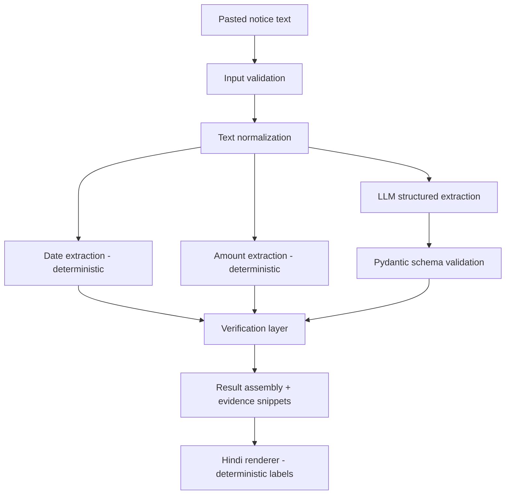

# Sarkari-Samajh-AI-Powered-Government-Notice-Explainer
 Hinglish (romanized Hindi) normalizer or sentiment classifier, a government-notice simplifier, or a form-explainer that turns legal or bureaucratic text into plain language. Low-resource languages are underserved, so even a small contribution stands out.
# Sarkari Samajh (सरकारी समझ)

**A verified NLP pipeline that turns Indian government notices into plain Hindi, with deterministic checks on every date and amount it reports.**

> **Product status:** Pre-alpha. V0 is fully specified, but **no pipeline code is implemented yet**. This README separates what is *implemented*, *in progress*, and *planned*; the status tables are the source of truth and must only be updated when code and passing tests exist. **No evaluation has been run, so this document contains no accuracy numbers.** See [Metrics and Results](#16-metrics-and-results).

**Status legend:** ✅ Implemented (code + passing tests) · 🔧 In progress · ⬜ Planned

---

## Table of Contents

1. [Project Overview](#1-project-overview)
2. [Problem Statement](#2-problem-statement)
3. [Why Existing Approaches Are Insufficient](#3-why-existing-approaches-are-insufficient)
4. [Product Vision](#4-product-vision)
5. [Current Status](#5-current-status)
6. [Architecture](#6-architecture)
7. [End-to-End Pipeline](#7-end-to-end-pipeline)
8. [Tech Stack](#8-tech-stack)
9. [Project Structure](#9-project-structure)
10. [Quick Start](#10-quick-start)
11. [Configuration](#11-configuration)
12. [Example Input and Output](#12-example-input-and-output)
13. [Engineering Decisions](#13-engineering-decisions)
14. [Design Tradeoffs](#14-design-tradeoffs)
15. [Evaluation Strategy](#15-evaluation-strategy)
16. [Metrics and Results](#16-metrics-and-results)
17. [Security / Trust Model](#17-security--trust-model)
18. [Roadmap](#18-roadmap)
19. [Limitations](#19-limitations)
20. [Contributing](#20-contributing)
21. [License and Author](#21-license-and-author)

---

## 1. Project Overview

Sarkari Samajh takes the text of an official notice (a scholarship circular, a government scheme announcement, or a university administrative notice) and produces a structured, citizen-readable Hindi explanation covering:

- what the notice is about,
- who it is addressed to,
- the important dates,
- the amounts, fees, benefits, or financial limits,
- the documents it asks for,
- what action the notice asks the reader to take.

The defining design choice is the split between two kinds of components:

| Kind | Responsibility |
|---|---|
| **Probabilistic (LLM)** | Understanding varied document structure, selecting the relevant information, writing simple Hindi |
| **Deterministic (code)** | Normalization, date/amount extraction, schema validation, and **verifying that every critical value the LLM reports actually exists in the source text** |

The original notice is the source of truth. The LLM output is an assistive interpretation layer and is never trusted for critical facts without an independent check.

**What this project is not:** it is not an official government service, not legal or eligibility advice, and not a general-purpose document summarizer.

---

## 2. Problem Statement

Official notices are written in formal, dense language, frequently mixing Hindi and English, with dates in several formats and amounts in Indian notation (`₹2,50,000`, `Rs. 12,000/-`, `५ लाख`). A citizen who finds or receives such a notice typically needs to answer six questions:

1. What is this about?
2. Does it apply to me?
3. What is the deadline?
4. Is there a fee, benefit, or financial condition?
5. Which documents do I need?
6. What do I do next?

Errors are asymmetric. A misleading summary sentence is an inconvenience; a **wrong deadline or a wrong amount** can cause a missed application or a wasted trip. The system is therefore designed around making critical-fact errors *detectable*, not around making the prose impressive.

---

## 3. Why Existing Approaches Are Insufficient

| Approach | Failure mode relevant to this problem |
|---|---|
| **"Summarize this notice in simple Hindi" (LLM-only)** | Generated prose can silently alter, merge, or invent dates and amounts. Nothing in the output says which facts are grounded. |
| **Regex/rule-only extraction** | Can find dates and amounts, but cannot decide which date is the *deadline* versus the issue date, nor explain eligibility or next steps in plain language. |
| **Machine translation / generic simplifiers** | Preserve the structure and difficulty of the original; do not extract action-oriented fields. |
| **LLM + "please be accurate" prompting** | Reduces but does not remove errors, and gives the reader no way to tell which statements are safe. |

The hypothesis this project tests, and has **not yet** measured, is that *structured extraction + deterministic verification* yields fewer unsupported critical claims than a generic summary prompt, and, just as importantly, makes the remaining uncertainty visible to the user. The [evaluation design](#15-evaluation-strategy) is written so that this hypothesis can fail.

---

## 4. Product Vision

The long-term pipeline is:

```
Document intake → text extraction → normalization → document understanding
→ structured extraction → critical fact verification → source grounding
→ plain-language explanation → user-facing action summary → evaluation & monitoring
```

Each roadmap version adds exactly one capability on top of the previous one (see [Roadmap](#18-roadmap)). This describes the intended direction. It is **not** the current state of the repository; see the next section.

---

## 5. Current Status

| Version | Capability | Status |
|---|---|---|
| V0 | Vertical slice: text → normalize → LLM extraction → date/amount verification → Hindi output (CLI) | 🔧 In progress (specified; code not yet written) |
| V1 | Hardened structured extraction + first labelled dev set (10 docs) | ⬜ Planned |
| V2 | Expanded verification (documents, date ranges, amounts in words, relative dates) | ⬜ Planned |
| V3 | Full source grounding (sentence evidence for all fields, offsets back to the original text) | ⬜ Planned |
| V4 | Evaluation benchmark (20–30 docs, baselines, metrics, readability proxy, user study) | ⬜ Planned |
| V5 | Document ingestion (PDF, OCR) | ⬜ Planned |
| V6 | Broader multilingual support (more regional languages, Hinglish robustness) | ⬜ Planned |
| V7 | Security and prompt-injection hardening | ⬜ Planned |
| V8 | Observability and deployment | ⬜ Planned |

**Implemented today:** nothing in the pipeline. This table changes only when code and tests are merged.

**A note on how this roadmap differs from a naive ordering:** V0 deliberately contains a *minimal* version of extraction and verification, because the product's central claim ("simplification *with* verification") cannot be demonstrated without both. V1 and V2 deepen those components rather than introduce them.

---

## 6. Architecture

### 6.1 Principle

> **Probabilistic language understanding + deterministic verification for critical facts. The model is never the source of truth.**

### 6.2 V0 architecture



The LLM receives the normalized text and returns JSON. It **does not** see the deterministic extractors' output and **does not** assign verification status. The verifier compares the two independent sources of evidence afterwards.

### 6.3 Responsibility split

| LLM (probabilistic) | Deterministic code |
|---|---|
| Interpret document structure and context | Unicode / numeral / whitespace normalization |
| Choose which dates, amounts, documents, steps are relevant | Date and amount extraction with character spans |
| Classify document type and the *role* of each date/amount | Pydantic schema validation |
| Write the simple Hindi summary and next steps | Canonicalization, comparison, verification status |
| | Hindi verification labels (never generated by the LLM) |

### 6.4 Data schema

The LLM and the system output are **separate models** so the LLM cannot self-certify.

```python
class DocType(str, Enum):
    SCHOLARSHIP = "scholarship"
    SCHEME = "scheme"
    ADMIN_NOTICE = "admin_notice"
    OTHER = "other"

class DateRole(str, Enum):
    DEADLINE = "deadline"
    START_DATE = "start_date"
    EVENT_DATE = "event_date"
    ISSUE_DATE = "issue_date"
    OTHER = "other"

class AmountRole(str, Enum):
    BENEFIT = "benefit"
    FEE = "fee"
    LIMIT = "limit"        # e.g. income ceiling
    OTHER = "other"

# ---------- Returned by the LLM (no verification fields) ----------
class ExtractedDate(BaseModel):
    value_as_written: str      # copied verbatim from the notice
    role: DateRole             # LLM judgement; NOT verified
    context: str               # short Hindi note

class ExtractedAmount(BaseModel):
    value_as_written: str
    role: AmountRole           # LLM judgement; NOT verified
    context: str

class LLMExtraction(BaseModel):
    document_type: DocType
    simple_summary: str                       # max 2 lines of simple Hindi
    target_audience: list[str] = []
    important_dates: list[ExtractedDate] = []
    amounts_and_benefits: list[ExtractedAmount] = []
    required_documents: list[str] = []
    next_steps: list[str] = []
    unclear_information: list[str] = []

# ---------- Produced by the system (verifier owns these fields) ----------
class VerificationStatus(str, Enum):
    VERIFIED = "verified"               # canonical value found in source
    NOT_FOUND = "not_found_in_source"   # parsed, but no matching value in source
    UNPARSEABLE = "unparseable"         # LLM value could not be normalized

class SourceEntity(BaseModel):          # from deterministic extractors
    raw: str
    canonical: str                      # "2026-12-15" or "250000"
    start: int
    end: int
    sentence: str                       # evidence

class VerifiedFact(BaseModel):
    value_as_written: str
    role: str                           # carried over, still LLM-assigned
    context: str
    status: VerificationStatus
    canonical: str | None = None
    evidence: str | None = None         # populated only when VERIFIED

class PipelineResult(BaseModel):
    document_type: DocType
    simple_summary: str
    target_audience: list[str]
    dates: list[VerifiedFact]
    amounts: list[VerifiedFact]
    required_documents: list[str]       # displayed as "not independently verified" in V0
    next_steps: list[str]
    unclear_information: list[str]
    source_dates_not_reported: list[SourceEntity]
    source_amounts_not_reported: list[SourceEntity]
```

`role` exists specifically so that *role errors* (for example, the LLM labelling an issue date as the deadline) can be measured against human labels. The verifier cannot catch them (see [Limitations](#19-limitations)).

### 6.5 Verification layer

**Invariants (each is covered by a unit test):**

1. Every date and amount reported by the LLM receives **exactly one** `VerificationStatus`.
2. A fact is `VERIFIED` **only if** its canonical value is in the set of canonical values the deterministic extractors found in the normalized source.
3. No code path produces `VERIFIED` without a source span to attach as evidence.
4. Verification status and its Hindi label are never produced by the LLM.

**Canonical forms and what is handled in V0:**

| Entity | Canonical form | Handled in V0 | Not handled in V0 |
|---|---|---|---|
| Date | ISO `YYYY-MM-DD` | `15/12/2026`, `15-12-2026`, `15.12.2026`, `15 December 2026`, `15 Dec 2026`, `15 दिसंबर 2026` (after numeral normalization); day-first assumed | Ambiguous or 2-digit years (→ `UNPARSEABLE`), Hindi number words, Vikram Samvat dates, fiscal-year expressions, relative deadlines ("within 30 days of issue"), elliptical ranges ("1 से 15 दिसंबर 2026") |
| Amount | Integer rupees (as `Decimal`, rendered as string) | `₹25,000`, `Rs. 25,000/-`, `रु. 25000`, `25,000 रुपये`, Indian grouping `1,00,000`, `5 लाख`, `2.5 lakh` | Amounts in Hindi words ("पच्चीस हजार"), ranges, percentages, numbers with no currency marker |

**Reverse check:** the verifier also reports dates and amounts that exist in the source but were *not* reported by the LLM (`source_*_not_reported`). This surfaces LLM recall failures that a forward-only check cannot see.

**What verification does and does not establish:** it establishes that a critical *value* can be **grounded in the source text**. It does **not** establish that the value plays the role the LLM assigned it, nor that the plain-language explanation is semantically correct.

### 6.6 Trust boundaries in the output

The renderer keeps three classes of content visibly separate:

1. **Extracted facts** (dates and amounts, each with a verification label and evidence),
2. **AI-generated explanation** (summary, audience, next steps),
3. **Unclear or unsupported information** (the `unclear_information` field and any `NOT_FOUND` / `UNPARSEABLE` items).

---

## 7. End-to-End Pipeline

| # | Stage | Input → Output | Failure behaviour |
|---|---|---|---|
| 1 | `validate_input` | raw string → raw string | Empty, over-length (configurable cap), or mostly non-text input raises `InputValidationError`. No LLM call is made. |
| 2 | `normalize_text` | raw → normalized text | Pure and idempotent. Converts Devanagari digits `०-९` to ASCII, removes zero-width characters, collapses whitespace, normalizes Unicode form. Never raises on valid strings. |
| 3a | `extract_dates` | normalized → `list[SourceEntity]` | Returns an empty list if nothing is found; never raises on odd text. |
| 3b | `extract_amounts` | normalized → `list[SourceEntity]` | Same as 3a. |
| 4 | `llm_extract` | normalized → raw JSON string | Provider/network errors raise `LLMError`. The notice is passed inside delimiters with an instruction to treat it as data. |
| 5 | schema validation | JSON → `LLMExtraction` | `ValidationError` triggers **one** repair re-prompt that includes the validation error; a second failure raises `ExtractionError`. No partial output is shown. |
| 6 | `verify_facts` | `LLMExtraction` + `SourceEntity` lists → `PipelineResult` | Total function: every LLM-reported date/amount gets a status. |
| 7 | `render` | `PipelineResult` → Hindi text | Verification labels come from a fixed template, not from the model. |

Cost per document in V0: one LLM call, plus at most one repair call.

---

## 8. Tech Stack

**Planned for V0:**

| Technology | Purpose |
|---|---|
| Python 3.11+ | Implementation language |
| Pydantic v2 | Schema validation for LLM output and system output |
| One LLM provider SDK (behind a thin `LLMClient` interface) | Structured extraction and Hindi generation; provider selected via environment variable |
| `python-dotenv` | Configuration from `.env` |
| `pytest` | Unit and pipeline tests |
| Python standard library (`re`, `datetime`, `decimal`, `unicodedata`, `logging`) | Normalization, extraction, verification |
| Streamlit (optional, last step of V0) | Thin UI wrapper over the same pipeline function |

**Deliberately not used in V0, and why:**

| Technology | Reason it is not needed yet |
|---|---|
| OCR / PDF parsing | Adds an independent error source that would obscure evaluation of the core pipeline (V5) |
| RAG / vector database | The notice itself contains the answer; no external retrieval is needed to say what a document states |
| Multi-agent frameworks / LangChain | Adds latency, cost, and debugging surface without addressing document understanding |
| `dateparser` | Fuzzy by design; a verifier should be strict and table-tested |
| Docker / cloud | No deployment requirement until the pipeline is evaluated (V8) |

---

## 9. Project Structure

Target V0 layout. Files are created as each build step lands; the Status column is updated only when the file exists with passing tests.

```text
sarkari-samajh/
├── src/sarkari_samajh/
│   ├── __init__.py
│   ├── normalize.py        # text normalization
│   ├── deterministic.py    # date + amount extractors (with spans)
│   ├── schemas.py          # all Pydantic models
│   ├── llm.py              # LLMClient interface, one provider, extractor
│   ├── verify.py           # fact verification
│   ├── pipeline.py         # orchestration
│   └── render.py           # Hindi output + labels
├── prompts/extract_v0.txt  # versioned prompt
├── data/raw/               # sample notices (public or synthetic only)
├── tests/
├── cli.py
├── requirements.txt
├── .env.example
├── .gitignore
└── README.md
```

| Path | Status |
|---|---|
| `normalize.py` | ⬜ Planned |
| `deterministic.py` | ⬜ Planned |
| `schemas.py` | ⬜ Planned |
| `verify.py` | ⬜ Planned |
| `llm.py`, `prompts/extract_v0.txt` | ⬜ Planned |
| `pipeline.py`, `render.py`, `cli.py` | ⬜ Planned |

Folders such as `grounding/`, `evaluation/`, `data/ground_truth/`, `docs/` and `app/` are **not created until they contain something real**. `evaluation/` arrives with V1 (dev set) and is formalized in V4. A module is split into a package only when a second file is needed.

---

## 10. Quick Start

> ⚠️ **Not runnable yet.** The commands below describe the intended V0 interface and will be verified and corrected when V0 is implemented. Do not treat them as tested.

```bash
# 1. Clone
git clone <repository-url>
cd sarkari-samajh

# 2. Create and activate a virtual environment
python -m venv .venv
# Windows (PowerShell):  .venv\Scripts\Activate.ps1
# macOS / Linux:         source .venv/bin/activate

# 3. Install dependencies
pip install -r requirements.txt

# 4. Configure (never commit .env)
cp .env.example .env        # then add your API key

# 5. Run the tests (no network or API key required)
pytest

# 6. Run the pipeline on a sample notice
python cli.py data/raw/sample_scholarship.txt
```

---

## 11. Configuration

All configuration is via environment variables (see `.env.example`). Interface is planned, not final.

| Variable | Description | Default |
|---|---|---|
| `LLM_PROVIDER` | Which provider implementation to load | none (required) |
| `LLM_MODEL` | Model identifier for that provider | none (required) |
| `<PROVIDER>_API_KEY` | API key for the selected provider | none (required) |
| `LLM_TEMPERATURE` | Sampling temperature | `0` |
| `MAX_INPUT_CHARS` | Input length cap enforced in validation | `20000` |
| `LOG_LEVEL` | Standard logging level | `INFO` |
| `LOG_RAW_TEXT` | Whether notice text may appear in logs | `false` |

> **Never commit API keys.** `.env` must stay in `.gitignore`.

---

## 12. Example Input and Output

> **This example is hand-written to illustrate the target output format. The notice is synthetic and is not a real government document. The output below was NOT produced by the system, because the system is not implemented yet.** It will be replaced with real, reproducible output once V0 runs.

**Input (synthetic notice, as pasted):**

```text
राज्य छात्रवृत्ति योजना 2026-27 (नमूना सूचना)

कक्षा 11 एवं 12 में अध्ययनरत अनुसूचित जाति के विद्यार्थियों से छात्रवृत्ति हेतु ऑनलाइन
आवेदन आमंत्रित हैं। आवेदन की अंतिम तिथि १५ दिसंबर २०२६ है। चयनित विद्यार्थियों को
प्रतिवर्ष रु. 12,000/- की छात्रवृत्ति प्रदान की जाएगी। आवेदन के साथ आय प्रमाण पत्र,
जाति प्रमाण पत्र एवं पिछली कक्षा की अंकतालिका अपलोड करना अनिवार्य है। परिवार की
वार्षिक आय ₹2,50,000 से अधिक नहीं होनी चाहिए।
```

**Target output:**

```text
क्या है ये?
यह कक्षा 11 और 12 के अनुसूचित जाति के विद्यार्थियों के लिए छात्रवृत्ति की सूचना है।
आवेदन ऑनलाइन करना है।

किसके लिए है?
• सूचना के अनुसार: कक्षा 11 एवं 12 में पढ़ रहे अनुसूचित जाति के विद्यार्थी

जरूरी तारीखें
• 15 दिसंबर 2026 — आवेदन की अंतिम तिथि        ✓ स्रोत में पुष्टि हुई
  स्रोत: "आवेदन की अंतिम तिथि 15 दिसंबर 2026 है।"

राशि / लाभ
• ₹12,000 प्रतिवर्ष — छात्रवृत्ति (लाभ)          ✓ स्रोत में पुष्टि हुई
  स्रोत: "चयनित विद्यार्थियों को प्रतिवर्ष रु. 12,000/- की छात्रवृत्ति प्रदान की जाएगी।"
• ₹2,50,000 — वार्षिक पारिवारिक आय की सीमा        ✓ स्रोत में पुष्टि हुई
  स्रोत: "परिवार की वार्षिक आय ₹2,50,000 से अधिक नहीं होनी चाहिए।"

जरूरी दस्तावेज  (AI द्वारा निकाला गया; स्वतंत्र रूप से सत्यापित नहीं)
• आय प्रमाण पत्र
• जाति प्रमाण पत्र
• पिछली कक्षा की अंकतालिका

आगे क्या करना है?
• ऑनलाइन आवेदन करें
• तीनों दस्तावेज आवेदन के साथ अपलोड करें
• अंतिम तिथि (15 दिसंबर 2026) तक आवेदन पूरा करें

सूचना में मिली अन्य तारीखें / राशियाँ जो ऊपर नहीं हैं: कोई नहीं

⚠ यह AI द्वारा बनाई गई सरल व्याख्या है। मूल सूचना ही आधिकारिक स्रोत है।
```

Notes on this example:

- The evidence sentences are quoted from the **normalized** text (the Devanagari digits `१५`, `२०२६` appear as `15`, `2026`). Mapping evidence back to character offsets in the *original* text is a V3 item, because whitespace collapsing breaks naive offsets.
- The income ceiling appears under "राशि / लाभ" with its role stated in the context. Role labelling is the LLM's job and is **not** verified.
- "सूचना के अनुसार" (according to the notice) is used on purpose; the system avoids phrasing such as "आप पात्र हैं" (you are eligible).

---

## 13. Engineering Decisions

Each decision records the problem, the choice, the alternatives, and the tradeoff accepted.

### 13.1 Hybrid NLP instead of LLM-only

- **Problem:** LLMs can alter or invent critical values with no visible signal.
- **Decision:** Critical entities (dates, amounts) are independently extracted by deterministic code and compared against the LLM's claims.
- **Alternatives:** LLM-only with careful prompting; rule-only extraction; a second LLM as a judge.
- **Tradeoff:** More code and a coverage ceiling set by the regex layer. In exchange, the check is deterministic, testable, cheap, and not subject to the same failure modes as the generator. An LLM-as-judge would share correlated errors with the generator.

### 13.2 Structured extraction with schema validation

- **Problem:** Free-text summaries cannot be validated, compared, or scored field-by-field.
- **Decision:** The LLM returns JSON validated by Pydantic; malformed output gets one repair attempt, then a typed error.
- **Alternatives:** Parse prose with regex; provider-native structured-output modes.
- **Tradeoff:** Schema constraints can reduce the model's expressiveness. Provider-native structured output may be adopted later behind the same interface; the validation layer stays regardless, because provider guarantees are not a substitute for validating at our boundary.

### 13.3 The LLM does not set `verified`

- **Problem:** A schema with `verified: true` inside the LLM's output lets the model grade itself.
- **Decision:** Two separate models: `LLMExtraction` (no status fields) and `PipelineResult` (verifier-owned status).
- **Tradeoff:** Slightly more schema code; removes an entire class of self-certification bug.

### 13.4 Verbatim value extraction (`value_as_written`)

- **Problem:** If the LLM paraphrases or reformats a value, a mismatch could be formatting or fabrication, and the two cannot be distinguished.
- **Decision:** The prompt requires dates and amounts to be copied exactly as written; the verifier canonicalizes both sides and compares canonical forms.
- **Tradeoff:** Constrains the model's output style for these fields (explanations go in `context`). Reduces false mismatches from formatting alone; does not eliminate them.

### 13.5 Reverse check (source → LLM)

- **Problem:** Forward verification only tests what the LLM *said*; it cannot detect a deadline the LLM *omitted*.
- **Decision:** Dates and amounts present in the source but not reported are surfaced to the user.
- **Tradeoff:** Can show noise (for example, a date that is irrelevant boilerplate). Chosen because an omitted deadline is a worse failure than extra noise.

### 13.6 Custom strict date/amount parsers instead of `dateparser`

- **Decision:** A small, table-tested parser for the formats Indian notices actually use. Day-first is assumed; ambiguous inputs become `UNPARSEABLE` rather than guessed.
- **Alternatives:** `dateparser` (supports Hindi, but is fuzzy and heavier), LLM-based normalization (circular).
- **Tradeoff:** Lower format coverage and more maintenance. A verifier that guesses is worse than one that abstains.

### 13.7 Text input first

- **Decision:** No OCR or PDF handling in V0.
- **Reason:** OCR adds an independent error source (Devanagari OCR can silently corrupt digits) that would make it impossible to attribute errors to the core pipeline. OCR is evaluated separately in V5.

### 13.8 No RAG initially

- **Reason:** The system answers *what this document says*. The document is already in context; retrieval from an external corpus would add a place for wrong information to enter and would blur the "source of truth is the notice" principle. RAG becomes relevant only if we later answer questions that need other documents (for example, cross-referencing a scheme's guidelines).

### 13.9 Single pipeline, not multi-agent

- **Reason:** Multiple agents add latency, cost, state, and failure modes. V0's problem (one document in, one structured result out) is a linear pipeline. Revisit only if a measured failure requires it.

### 13.10 LLM client behind an interface; fake model in tests

- **Decision:** `LLMClient.complete(system, user) -> str`. Pipeline tests inject a fake client.
- **Tradeoff:** One thin abstraction. Justified because it makes the central claim testable offline: *a hallucinated deadline returned by a fake LLM must be flagged*.

### 13.11 Flat package for V0

- **Decision:** One module per concern, not nested subpackages.
- **Reason:** Subfolders holding one file each add navigation cost without structure benefit. Split when a second file appears.

### 13.12 Evaluation harness begins early

- **Decision:** A labelled dev set starts in V1, even though the formal benchmark is V4.
- **Reason:** Prompt and parser changes made without any labelled data are guesses. The *eval* set is kept separate and frozen (see [Evaluation Strategy](#15-evaluation-strategy)).

---

## 14. Design Tradeoffs

| Tradeoff | Choice made | Cost accepted |
|---|---|---|
| Verifier strictness vs. coverage | Strict: abstain (`UNPARSEABLE`) rather than guess | More "could not verify" labels on unusual formats; the user sees ⚠ more often |
| False `NOT_FOUND` vs. false `VERIFIED` | Prefer false `NOT_FOUND` | Some correct values get flagged; fewer wrong values pass |
| Presence check vs. semantic check | Presence of value only | Role errors (issue date labelled as deadline) pass verification; mitigated by measuring role accuracy separately and showing evidence sentences |
| Single LLM call vs. multi-stage | One call + at most one repair | Less specialization per field; simpler to debug and cheaper |
| Day-first date assumption | Assumed | Wrong for any notice using month-first; ambiguous cases abstain |
| Hindi-only output in V0 | Hindi | Does not serve other regional-language readers (V6) |
| Third-party LLM API | Used | Notice text is sent to an external provider; see [privacy note](#17-security--trust-model) |
| Small labelled set | Chosen for feasibility | Results cannot establish generalization |

None of this implies the hybrid design is universally superior. It is a reasonable starting point for a high-stakes extraction problem, and the evaluation is designed to show where it falls short.

---

## 15. Evaluation Strategy

> No evaluation has been run. This section describes the **protocol** that will be followed; results go in [Section 16](#16-metrics-and-results) only after the evaluation is executed.

### 15.1 Principles

1. **Unit tests check that the code is correct; evaluation measures how well the system works.** They are separate and never conflated.
2. **Dev and eval sets are separate.** Prompts and parsers are tuned on the dev set (V1, 10 docs). The eval set (V4, target 20–30 docs) is frozen before final runs; no prompt changes after looking at eval results.
3. **Failures are reported.** Every report includes a failure analysis of concrete cases.
4. **Counts alongside rates.** With ~20–30 documents, report absolute counts and a Wilson 95% interval for proportions. Do not claim statistical significance.
5. **Reproducibility metadata** is recorded with every run: model identifier, run date, temperature, prompt version hash, code commit.

### 15.2 Dataset

| Property | Plan |
|---|---|
| Size | 10 dev (V1) → 20–30 eval (V4) |
| Categories | Scholarship, government scheme, public/university administrative notice; roughly balanced |
| Source | Publicly available official notices; each record stores source URL, retrieval date, and a note on reuse terms |
| Excluded | Documents with personal data (names, Aadhaar/phone numbers, addresses) unless redacted |
| Annotation | Author labels first; a second person independently labels a subset and agreement is reported. A single annotator is a stated limitation until then |

**Ground-truth record:**

```json
{
  "document_id": "001",
  "document_type": "scholarship",
  "source_url": "...",
  "retrieved_on": "YYYY-MM-DD",
  "deadlines":  [{"canonical": "2026-12-15", "source_span": "..."}],
  "other_dates": [],
  "amounts":    [{"canonical": "12000", "role": "benefit", "source_span": "..."}],
  "required_documents": ["income certificate", "caste certificate"]
}
```

### 15.3 Systems compared

| ID | System | Purpose |
|---|---|---|
| **B0** | Generic baseline: *"Summarize this government notice in simple Hindi."* | The comparison required by the project goal |
| **B1** | Structured extraction + schema validation, **no verification** | Ablation: separates the effect of structured prompting from the effect of verification |
| **P** | Full pipeline: structured extraction → validation → verification → grounded output | The proposed system |

All three use the same model, temperature, and normalized input. B1 is included because comparing only B0 vs. P would credit "verification" for gains that structured prompting alone may provide.

### 15.4 Metrics (definitions)

| ID | Metric | Definition |
|---|---|---|
| M1 | **Deadline recall / precision** | Recall: ground-truth deadlines matched by a system date with `role=deadline` and equal canonical value ÷ total GT deadlines. Precision: matched ÷ system-reported deadlines |
| M2 | **Amount recall / precision** | Same, matching on canonical integer rupees |
| M3 | **Required-documents P / R / F1** | Reported **strict** (normalized string match) and **lenient** (annotator-judged semantic match with a written rubric) |
| M4 | **Unsupported critical claim rate** | Critical claims (dates + amounts) whose canonical value is not in the source ÷ total critical claims. Computed for B0 (claims extracted from the free-text summary using the same deterministic extractors), B1 and P-before-verification (raw LLM output) |
| M5 | **False-verification rate** | For P: claims displayed as `VERIFIED` that a human judges unsupported ÷ claims displayed as `VERIFIED` |
| M6 | **Role error rate** | Among verified claims, fraction whose LLM-assigned role is wrong per human label. This is the verifier's known blind spot, so it is measured directly |
| M7 | **Verifier detection quality** | Using human `supported / unsupported` labels on all claims: precision and recall of the `NOT_FOUND` flag |
| M8 | **Fault-injection detection rate** | Synthetically corrupt correct LLM outputs (change a date or amount) and measure how often the verifier flags them. This is a **stress test of the mechanism**, not an estimate of real-world hallucination frequency |
| M9 | **Output consistency** | Run each document N=5 times at the fixed configuration; report mean pairwise Jaccard similarity of canonical date/amount sets |
| M10 | **Readability proxy** | Mean sentence length (tokens) and long-word ratio (tokens above a fixed character threshold) for source, B0 output and P output |
| M11 | **Operational** | Latency p50/p95, tokens per document, cost per document, schema-failure rate, repair rate |

**Circularity caveat for M4/M5.** For system P, the verifier and the unsupported-claim measurement use the same deterministic grounding check, so measuring P's hallucination rate *with the verifier* would be circular. Therefore: (a) M4 is reported on **raw** LLM output before verification, (b) M5 is judged by a **human**, not the verifier, and (c) a manual audit covers all claims on the eval set.

**Readability caveat.** No formal Hindi readability index is claimed. Sentence length and long-word ratio are crude **proxies**; shorter sentences are not necessarily easier to understand. The user study (15.5) is the primary evidence of comprehension.

### 15.5 Human evaluation (exploratory)

- 5 outputs shown to 3–5 people unfamiliar with formal government language; presentation order randomized between B0 and P outputs where both are shown.
- Questions: (1) What was the notice about? (2) What is the important date? (3) What action do you need to take? (4) Which part was confusing?
- Answers are scored against the ground truth for correctness (not self-reported "I understood").
- Participants give informed consent; no personal data is recorded.
- Reported as counts in an **exploratory study**, not as a statistically meaningful result.

### 15.6 Testing (separate from evaluation)

| Layer | What it covers |
|---|---|
| Unit: normalization | Digit conversion, zero-width characters, whitespace, idempotence |
| Unit: extractors | Table-driven positive cases for date/amount formats; negative cases (phone numbers, "page 3 of 10", 2-digit years) |
| Unit: verifier | Same value in a different format → verified; fabricated date → `NOT_FOUND`; garbage → `UNPARSEABLE`; the four invariants in 6.5 |
| Pipeline (fake LLM) | **Core test:** the fake LLM returns the wrong deadline and the result must be `NOT_FOUND`. Malformed JSON → one repair, then typed error. An omitted source date appears in `source_dates_not_reported`. An injection string in the notice does not alter a verified result |
| Integration (optional) | One real-provider run, marked and skipped without an API key; asserts schema validity only, not wording |

---

## 16. Metrics and Results

**No results exist yet.** Every cell below stays empty until the evaluation in Section 15 is actually run. Do not fill in estimates.

| Metric | B0 (generic) | B1 (structured, no verification) | P (full pipeline) |
|---|---|---|---|
| M1 Deadline recall / precision | not measured | not measured | not measured |
| M2 Amount recall / precision | not measured | not measured | not measured |
| M3 Required-docs P / R / F1 (strict, lenient) | not measured | not measured | not measured |
| M4 Unsupported critical claim rate | not measured | not measured | not measured |
| M5 False-verification rate | n/a | n/a | not measured |
| M6 Role error rate | n/a | not measured | not measured |
| M7 Verifier detection precision / recall | n/a | n/a | not measured |
| M8 Fault-injection detection rate | n/a | n/a | not measured |
| M9 Consistency (Jaccard, N=5) | not measured | not measured | not measured |
| M10 Readability proxy | not measured | not measured | not measured |
| M11 Latency / tokens / cost | not measured | not measured | not measured |

**Reporting rules once results exist:** state n (documents and claims), model identifier, date, temperature, prompt version, and commit; give counts with intervals; report dev and eval separately; include a failure analysis with at least five concrete failure cases; state plainly if P does **not** outperform B0 or B1 on any metric.

---

## 17. Security / Trust Model

### 17.1 Untrusted input

The pasted notice is **untrusted data**. It could be malformed, adversarial, or contain text that looks like instructions.

- The notice is passed to the LLM inside explicit delimiters with an instruction to treat it as data to analyze, not instructions to follow. **This is a mitigation, not a defense**; dedicated prompt-injection handling is V7.
- The V0 LLM has **no tools and no side effects**. The worst case of a successful injection in V0 is wrong output *text*, which limits the blast radius.
- The deterministic verifier never interprets instructions in the source, so an injected "the deadline is 1 January" cannot upgrade a value to `VERIFIED` unless that value genuinely appears in the notice. It *can* still mislead if the injected text itself contains a plausible date, which is a limit of presence-based verification.

### 17.2 Claims the system must not make

- No legal advice or eligibility *decisions*. Output is phrased "सूचना के अनुसार…" (according to the notice…), not "आप पात्र हैं".
- No claim of government endorsement or official verification. The UI states that the original notice is the authoritative source.
- No invented next steps: steps must be supported by the notice; unsupported or ambiguous items go to `unclear_information`.

### 17.3 Privacy

- Notice text is sent to a third-party LLM API. Do not submit notices that contain sensitive personal data you are not willing to share with that provider.
- Raw notice text is **not logged by default** (`LOG_RAW_TEXT=false`).
- V0 performs **no PII redaction**. Redaction of identifiers such as Aadhaar numbers is not implemented.
- The repository must contain only public or synthetic notices.

### 17.4 Secrets

API keys come from environment variables; `.env` is gitignored; no key appears in code, logs, or test fixtures.

---

## 18. Roadmap

| Version | Capability | Status |
|---|---|---|
| V0 | Vertical slice (text → normalize → extract → verify → Hindi output) | 🔧 In progress |
| V1 | Hardened structured extraction + 10-doc labelled dev set | ⬜ Planned |
| V2 | Expanded verification | ⬜ Planned |
| V3 | Full source grounding | ⬜ Planned |
| V4 | Evaluation benchmark | ⬜ Planned |
| V5 | Document ingestion (PDF/OCR) | ⬜ Planned |
| V6 | Broader multilingual support | ⬜ Planned |
| V7 | Security and prompt-injection handling | ⬜ Planned |
| V8 | Observability and deployment | ⬜ Planned |

A version is marked ✅ only when its code is merged and its tests pass.

### V0: Vertical slice
- **Adds:** end-to-end CLI pipeline for one pasted notice; normalization; deterministic date/amount extraction; LLM structured extraction; verification with evidence snippets; Hindi rendering with verification labels.
- **Motivation:** demonstrate the core claim end-to-end before widening anything.
- **Decisions:** hybrid architecture, separate LLM/system schemas, strict parsers, injected LLM client (Section 13).
- **Tests:** unit + fake-LLM pipeline tests, including the wrong-deadline test.
- **Acceptance criteria:**
  1. CLI runs on 3 sample notices (one per category) and prints all sections in Hindi.
  2. Every date and amount shows a verification status; verified items show an evidence sentence.
  3. The wrong-deadline test passes: a hallucinated date is never shown as verified.
  4. Invalid LLM output raises a typed error; there is no silent fallback.
  5. `pytest` passes with no network and no API key.
  6. No secrets in code; configuration via `.env`.
  7. README status and limitations are accurate; no accuracy numbers appear.
- **Known limitations:** presence-only verification; documents unverified; 3 sample notices; no generalization claim.

### V1: Hardened structured extraction
- **Adds:** per-document-type prompt variants, repair-loop refinement, 10 labelled dev documents, a first scoring script.
- **Motivation:** tune against data rather than intuition.
- **Limitations:** dev-set tuning risks overfitting; hence the frozen eval set in V4.

### V2: Expanded verification
- **Adds:** required-documents literal/fuzzy grounding, elliptical date ranges, amounts in words, relative-deadline detection (flagged, not resolved), simple role heuristics.
- **Limitations:** each new heuristic needs its own negative test cases.

### V3: Full source grounding
- **Adds:** sentence evidence for every field, offsets mapped back to the *original* text, highlighted source view.
- **Limitations:** evidence supports a claim; it does not prove the explanation is correct.

### V4: Evaluation benchmark
- **Adds:** 20–30 document eval set, B0/B1/P comparison, metrics M1–M11, readability proxy, exploratory user study, failure analysis.
- **Limitations:** small sample; single-domain; see Section 19.

### V5–V8
- **V5:** PDF and OCR ingestion, evaluated *separately* so OCR errors are attributable.
- **V6:** additional regional languages and Hinglish robustness; low-resource language evaluation.
- **V7:** prompt-injection test suite, input sanitization, output policy checks.
- **V8:** structured logging, latency/cost tracking, deployment. This is the earliest point at which operational claims are appropriate.

---

## 19. Limitations

1. **Verification is presence-based.** It confirms a value appears in the source, not that the value has the role the LLM claims. An issue date labelled "deadline" passes. (Measured separately as M6.)
2. **Coincidental matches.** A value can be grounded because the same date or amount appears elsewhere in the notice in a different context.
3. **Coverage of formats is finite.** Hindi number words, Vikram Samvat dates, fiscal-year expressions, relative deadlines ("within 30 days of issue"), elliptical ranges, and times of day are not verified in V0. These produce `UNPARSEABLE` or go unreported.
4. **Day-first assumption** for numeric dates; month-first notices will not be handled correctly.
5. **Required documents are not independently verified in V0.** They are labelled as such in the output.
6. **Eligibility logic is not interpreted.** Complex conditions ("only if X and not Y unless Z") may be mis-summarized; they need human review.
7. **Evidence is quoted from normalized text**, not offset-mapped to the original, until V3.
8. **No OCR or PDF support;** text input only. OCR errors would affect everything downstream when added.
9. **Evaluation validity (once run):** small dataset, a single annotator initially, notices drawn from a limited set of sources, one model and one prompt version. Results will not establish generalization to other states, departments, or languages.
10. **LLM variability.** Output wording and recall can vary run to run even at temperature 0; consistency is measured (M9), not assumed.
11. **Third-party API dependency,** with data-privacy implications (Section 17.3).
12. **Not legal or official advice.** The system is an information-assistance tool.

---

## 20. Contributing

1. Fork the repository and create a feature branch.
2. Keep changes small and tied to a roadmap version; say which one in the pull request.
3. Add tests with every behaviour change. Extractor and verifier changes need **negative** cases as well as positive ones.
4. Do not add or change numbers in the README unless they come from a committed evaluation run.
5. Update the status tables honestly: do not mark anything ✅ without merged code and passing tests.
6. Data contributions must be public or synthetic, must record source URL and retrieval date, and must not contain personal data.
7. Never commit API keys or `.env`.

---

## 21. License and Author

- **License:** Not yet specified.
- **Repository:** `https://github.com/Ragini-Roy7/Sarkari-Dost-AI-Powered-Government-Notice-Explainer`
- **Author:** `Ragini Roy/https://github.com/Ragini-Roy7 `
